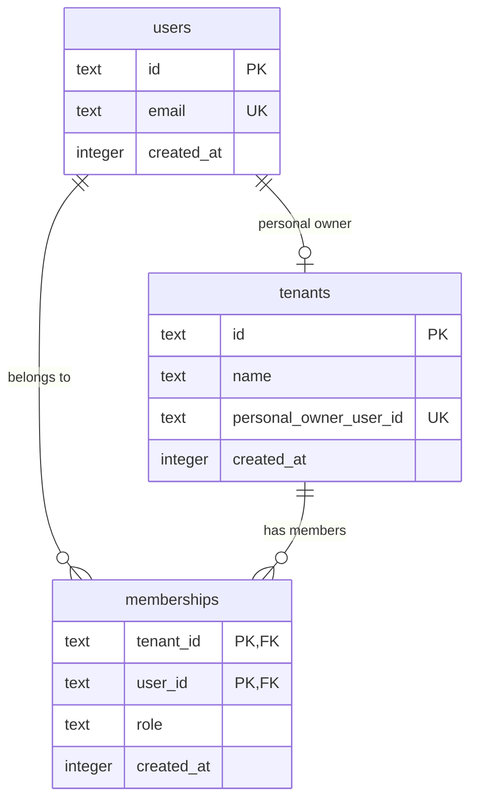

# @maxhill/auth

OpenAuth-based authentication service for maxhill.me.

Runs as a long-running Bun-compiled binary on the VPS. Storage is
SQLite; email delivery is Resend. Follows the standard on-box config
convention (see [`docs/vps.md`](../../docs/vps.md)): systemd loads a
dotenv file with `EnvironmentFile=` and the binary reads
`process.env`.

## Layout

```
apps/auth/
├── src/
│   ├── index.ts           entry point + subcommands
│   ├── config.ts          env-var parser (valibot)
│   ├── sqlite-storage.ts  OpenAuth storage + SQLite schema initialization
│   ├── user-database.ts   User and personal-tenant provisioning
│   └── subjects.ts        JWT subject definitions (exportable)
└── package.json
```

Systemd units live under `vps/auth/`:

- `auth.service` — the long-running server.
- `auth-sweep.service` + `auth-sweep.timer` — hourly `DELETE` of
  expired KV rows. Enabled once by bootstrap.

## CLI

```
auth-exe run     # start the HTTP server on :3002
auth-exe sweep   # DELETE expired rows, exit 0
```

Both subcommands read the same env vars. `sweep` is invoked by
`auth-sweep.timer`; `run` is invoked by `auth.service`.

## Config

Read from `process.env`:

- **`ISSUER`** — public URL announced in OAuth discovery and baked
  into issued tokens.
- **`DB_PATH`** — SQLite file. On prod this is under the systemd
  `StateDirectory=auth`, i.e. `/var/lib/auth/`.
- **`RESEND_API_KEY`** — Resend API key used to send verification codes.
  `from` address is hardcoded to `auth@maxhill.me`.

Port (3002), email `from` address, and the schema itself are code-side
constants. If any of them need to vary per environment, promote them
into the env schema.

## Local development

Create `vps/auth/auth.dev.env` (gitignored) with a real Resend API
key. Use `:memory:` for the DB so state resets on every restart:

```
ISSUER=http://localhost:3002
DB_PATH=:memory:
RESEND_API_KEY=re_…
```

Swap in a file path (e.g. `./auth.dev.db`) if you want state to
survive restarts.

`apps/auth/mise.toml` loads that file via `[env]._.file`. Run
dev from anywhere:

```bash
cd apps/auth && mise run run
```

Same code path as production, only the env source differs.

Discovery endpoint: <http://localhost:3002/.well-known/oauth-authorization-server>.

## Production deploy

`mise run deploy:auth` from the repo root. See `vps/auth/deploy.ts`:
it builds the binary with `bun build --compile
--target=bun-linux-x64`, compiles and ships `deploy-remote.ts`, rsyncs
artifact + encrypted env, then the remote deploy binary decrypts to
`/etc/auth/auth.prod.env`, atomically swaps `/opt/auth/current`, and
restarts `auth.service`.

Rotating `RESEND_API_KEY` (or any prod env var): `sops edit
vps/auth/auth.prod.enc.env`, commit, redeploy. Full flow in
`docs/vps.md`.

## Database setup

The service opens the SQLite file named by `DB_PATH`. On startup,
`openDatabase()` creates any missing tables and indexes. This also runs
for the `sweep` command. Existing databases keep their OpenAuth `kv`
rows; relational tables are added alongside them.

Local development can use `:memory:` to reset all state on restart, or
a file path to preserve state. Production stores the file under
`/var/lib/auth/`. SQLite uses WAL mode.

## Data model and permissions

OpenAuth session and verification state stays in `kv`. The relational
tables store identity and tenant ownership:



A successful password login or signup ensures a user row, one personal
tenant, and an `owner` membership. The membership is the permission
relationship: it records which user belongs to which tenant and their
role. The owner role identifies the user's authority over their
personal tenant. These tables do not yet expose tenant APIs or enforce
membership checks on sync requests; those are later work.

`users.email` is unique. `tenants.personal_owner_user_id` is nullable
and unique: it links a personal tenant to its owner and prevents more
than one personal tenant per user. Shared tenants can leave it null.
Memberships have a composite key `(tenant_id, user_id)` and foreign
keys to users and tenants.

## User IDs

User IDs continue to use the existing `user_`-prefixed SHA-256 email
hash so current token subjects and client ownership remain stable.
The relational user row now persists that ID and the unique email.
Tenant IDs are UUIDs generated when a personal tenant is created. A
later migration can move user IDs to UUIDs after users have updated.

## Client usage

```ts
import { subjects } from "@maxhill/auth/subjects"
import { createClient } from "@openauthjs/openauth/client"

const client = createClient({
  clientID: "my-app",
  issuer: "https://auth.maxhill.me",
})

const verified = await client.verify(subjects, accessToken, { refresh: refreshToken })
if (!verified.err) {
  console.log(verified.subject) // { type: "user", properties: { userID: "..." } }
}
```
